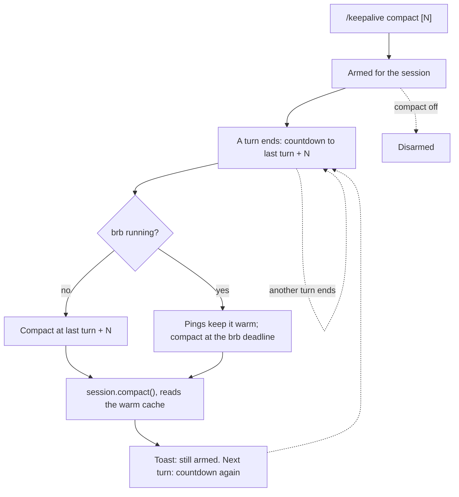

# brb and compact

Part of [cache-keepalive](../README.md).

Two commands cover a session you are not watching:

- **`/keepalive brb <time>`** says how long you are away. Pings keep the cache warm until then. It ends when you type a prompt (a monitor event or a `/goal` step does not end it). Type it any time, even before the first turn ends or while a `/goal` runs. The time counts from when the command runs, not when you typed it: a command typed during a turn waits for the turn to end, so the window starts then. The pings are worked out when the turn ends.
- **`/keepalive compact [N]`** arms a compact for the whole session: N minutes (default 50) after the last turn, while the cache is still warm, and again in every later idle stretch, until `/keepalive compact off`. N is kept; a bare `compact` keeps it, `compact 45` changes it. N can be at most the TTL minus `compactLeadMinutes` (50 on a 1h cache).

Compacting is lossy, so nothing compacts unless you arm it (or set `compactBeforeExpiry`, which starts every session armed). It reads the warm cache, so it is cheap: your next prompt rewrites a small summary instead of the whole context.

## When it compacts

The compact fires at **the later of (last turn + N) and the end of the `brb`**. Nothing else moves it, and every new turn restarts the countdown.

| You do | Pings | Compact |
|---|---|---|
| `compact`, then walk away | none | 50 min after the last turn |
| `compact 45` | none | 45 min after the last turn |
| `compact` and `brb 180` (either order) | at +50, +100, +150 | at +180, while the cache is still warm |
| `brb 20` with a compact armed | none (the `brb` ends before the first ping) | 50 min after the last turn |
| you type a prompt during a `brb` | the `brb` ends | N min after that turn |

Pings are only the ones that come before the compact, one every 50 minutes. A 6-hour `brb` is 7 pings, about $0.20 (more in [cost.md](cost.md)).

## What does not disarm it

A prompt you type, a `/goal` step, a monitor's notification, a compaction that was skipped or refused. After a compact the context is small, so it compacts again only once it has grown past `minContextTokens` (50k). Every compact ends with a toast saying it is still armed, and `✂` stays on the status line. It lasts for this session only.

## Background tasks

If a Monitor or a shell is still running when the turn ends, keepalive does **not** wait for it: the compact is what you armed. It warns once (a toast and `⚠bg` in the status line). To keep the full context while they run, add `brb <time>`. A monitor keeps delivering events after a compact.

## Claude Code's own idle compaction

Claude Code (2.1.290+) can also compact an idle session itself: at 200k+ tokens, idle for "about an hour" (`idleCompaction`, on by default; `CLAUDE_CODE_IDLE_COMPACT_MIN_TOKENS` changes the size). Keepalive notices it, cancels its own timers and resets its state, so nothing is pinged against a prefix that no longer exists. The default 50 minutes comes first anyway. To keep pinging for the full context instead, set `"idleCompaction": false` in settings.json.

## Removed in 0.8.0

`compact pings` (`c p`) and `done` (`d`). Use `brb` for long absences and `maxPings: 0` to stop the pings.

Edge cases, the measurements behind this and the design decisions: [design.md](design.md).
