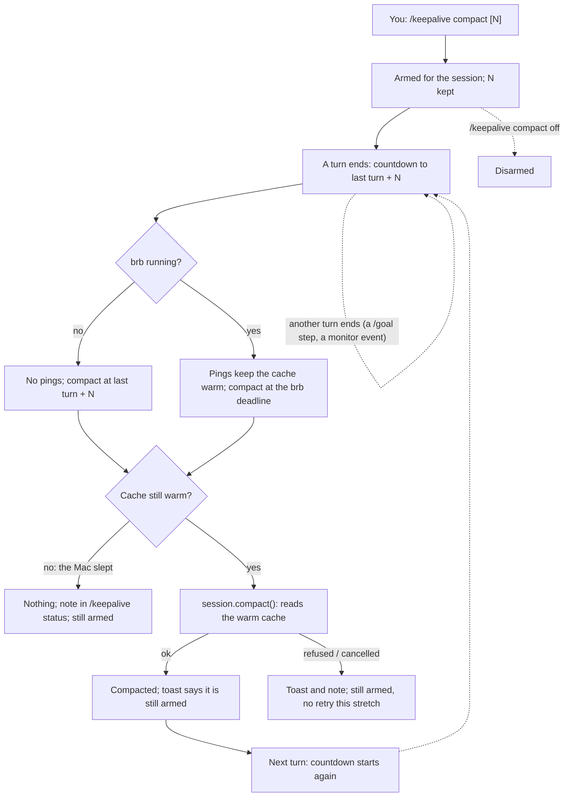

# Compact before expiry

Part of [cache-keepalive](../README.md).

`/keepalive compact [minutes]` arms a compact **for the whole session**. `minutes` is N: the compact fires N minutes (`compactAfterMinutes`, default 50) after the last turn ends, while the cache is still warm, and again in every later idle stretch, until `/keepalive compact off`. N must be at most the TTL minus `compactLeadMinutes` (50 on a 1h cache), or the command refuses. N is kept with the arming: a later bare `/keepalive compact` keeps it, and `/keepalive compact 45` changes it.

Compacting is lossy, so nothing compacts unless you arm it (or set the `compactBeforeExpiry` option, which only means "start every session armed"). The reply states the context size, every compact ends with a toast saying it is still armed, and the status line shows `✂` for as long as it is armed.

## One rule

The compact fires at **max(last turn + N, the end of the `brb` window)**. Nothing else moves it.

| You do | Pings | Compact |
|---|---|---|
| `/keepalive compact` and walk away | none | 50 min after the last turn |
| `/keepalive compact 45` | none | 45 min after the last turn |
| `compact` then `brb 180` (either order) | at +50, +100, +150 | at +180, the brb deadline, while the cache is still warm |
| `compact`, a monitor event at +60 during `brb 240` | re-derived at each turn end to reach +240 | at +240 |
| you type a prompt during a `brb` | the brb ends | N minutes after that turn |

A monitor event (`<task-notification>`), a `/goal` step, another session's message and a slash command never end a `brb`; the next prompt you type does. (`UserPromptSubmit` has no `source` in this build, so those prefixes are what tells them apart; measured.) A new turn of any kind restarts the countdown.

## What does not disarm it

A prompt you type, a `/goal` continuation, a background task's notification, and a compaction that was skipped, refused or fired late. After a compact the context is small, so it compacts again only once the context has grown back past `minContextTokens`. `/keepalive status` shows `last compact note`. The arming lasts for this session only.

## Background tasks

A turn can end while a Monitor or a shell is still running (an agent waiting on a two-hour build). Keepalive reads the Stop hook's `background_tasks` (monitors and shells; measured on 2.1.330) and, with a compact armed and no `brb` running, warns once per stretch (a toast, and `⚠bg` in the status line) that the compact will run at N anyway. Without a `brb` it does not wait for them: the compact is what you armed. A monitor keeps delivering events after a compact (measured). To keep the full context while they run, say how long you are away with `/keepalive brb <time>`.

Solid arrows are the main path, dashed arrows are optional or restart it. Nothing in the chart disarms the compact except `compact off`.

## Timeline

Times are minutes after the last turn ends, with the defaults (1h TTL, `leadMinutes` 10, `compactLeadMinutes` 10, N 50):

```mermaid
gantt
  title Minutes after the last turn ends (defaults, compact and brb 180)
  dateFormat HH:mm
  axisFormat %H:%M
  section Cache
    Warm, nothing happens           :done, w1, 00:00, 50m
    Ping 1, cache now lasts to 1h50 :milestone, p1, 00:50, 0m
    Warm after ping 1               :done, w2, 00:50, 50m
    Ping 2, lasts to 2h40           :milestone, p2, 01:40, 0m
    Warm after ping 2               :done, w3, 01:40, 50m
    Ping 3, lasts to 3h30           :milestone, p3, 02:30, 0m
  section Compact
    Compact at the brb deadline     :crit, c, 03:00, 10m
```

- **0 → 50:** nothing happens. Without a `brb` the compact fires at 50 and there are no pings at all.
- **50, 100, 150:** with `brb 180`, each ping reads the whole prefix, which restarts the 60-minute clock, so the cache would now last to 110, 160, 210. A ping starts `leadMinutes` (10) before the current expiry, hence a 50-minute interval.
- **180:** the `brb` deadline. The summary request reads the warm cache (it takes about a minute at 140k tokens) and the cache is still good until 210. The new prefix is not cached yet, so nothing is kept warm until your next turn.

Pings cost far less than the one rewrite they avoid: see [cost.md](cost.md) (7 pings for a 6 h `brb` at 142k tokens cost about $0.20 against $0.57 to $2.84 for a rewrite, depending on the model; the break-even is 20 to 80 pings).

## The engine's own idle compaction

Claude Code (v2.1.290+, per its docs) can compact an idle session itself: a conversation at 200k context tokens or more (`CLAUDE_CODE_IDLE_COMPACT_MIN_TOKENS`, at least 100k) left idle for "about an hour". The docs give no exact minutes (54 appears only in third-party write-ups). Whether it is on depends on `idleCompaction` (default `true`), on `autoCompactEnabled` (the `/config` Auto-compact toggle; the settings docs do not describe it and reports disagree on how it behaves) and on a server-side flag, so keepalive cannot know.

This is not a turn, so `turn.complete` never fires. Keepalive hooks `session.compact` with `trigger: 'auto'` (which covers this and the over-threshold auto-compact): it cancels the pending ping and compact timers before the compaction runs, then resets `phase` to `active` and `contextTokens` to the compacted size once it resolves. Without that, a ping timer firing after the engine already compacted would read the miss as a cache/TTL mismatch and turn keepalive off for the session. A vetoed auto-compaction (a `PreCompact` hook blocking it) changes nothing, and keepalive's schedule is restored. The armed compact stays armed through it.

The default N of 50 minutes comes before "about an hour", so for a session that is armed, keepalive's own compact normally runs first. If you would rather keep pinging to preserve the full context, set `"idleCompaction": false` in settings.json, or raise `CLAUDE_CODE_IDLE_COMPACT_MIN_TOKENS` past your usual context size.

## Aliases and what was removed

`/keepalive c` is `compact`, `p` is `ping`, `s` is `status`. `compact pings` (and `c p`) and `done` were removed in 0.8.0: the first made the compact wait for every ping to be used up, and `brb` could silently switch a timed compact into it; use `compact` with `brb` instead. To stop the pings, set `maxPings` to `0`.
