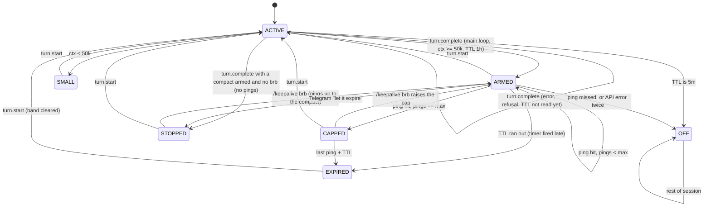

# Design notes

Part of [cache-keepalive](../README.md). Why it works this way and what was measured. How to use it: the [README](../README.md). The long product spec this replaces is in git history (`docs/PRD.md`, up to plugin 0.8.0).

Facts marked **measured** were observed in real Claude Code sessions (2.1.289 for the original plugin, 2.1.330 for the armed compact and `brb`); **docs** are from the official Claude Code docs; **read** from the API types or code.

## How it works

- **The ping** is `$.model.fork` with a short prompt: one tool-less request over the main thread's last prefix. It reads the prefix from cache (restarting the TTL) and never lands in the transcript, so nothing needs rewinding. A ping costs the cache-read rate over the whole prefix, not "under 100 tokens": [cost.md](cost.md).
- **Hit test:** the fork's own `cache_read / (input + cache_read + cache_creation)` must be at least 0.8. (`turn.complete`'s usage is summed over every API call in the turn, so it cannot be used.) A miss turns keepalive off for the session, after at most one wasted ping.
- **The TTL is read, not assumed:** the turn's usage has no 1h/5m split, so the plugin reads `cache_creation.ephemeral_1h_input_tokens` / `ephemeral_5m_input_tokens` from the transcript's tail (`tail -c 262144`, because `$.fs.read` rejects files over 4 MiB). A 5-minute TTL turns keepalive off: about 13 pings an hour cost more than one rewrite.
- **Timing:** a ping is due at `max(last response, last ping) + TTL − leadMinutes` (50 minutes on a 1h cache). A timer that fires after the cache already expired (the Mac slept) skips the ping.
- **State:** per session in `$.state` (`cache-keepalive.session`, declared in `types/index.d.ts`), so a hot reload re-arms from it; totals across sessions in `$.store`. The status line reads `~/.claude/keepalive/<session_id>.json`, which is data, not display text.
- **Main loop only:** `turn.start` fires only for the main loop; a subagent's turns neither arm nor cancel. The context size comes from `$.session.usage().context.tokens`.
- **Authoring constraint:** `claude plugin validate` refuses passing `$` to a function defined inside `register`, so helpers that take `$` are top-level.

## Display

- **A status line field, not `$.ui.status`.** **Measured:** `$.ui.status` is drawn as its own row with a forced warning glyph and the plugin's name, so it is only used when you opt in (`engineStatus`).
- **It replaces ccstatusline's Cache Timer** (**read**, 2.2.30): that widget counts from the transcript's last assistant message, and a ping never reaches the transcript, so after a ping it falls to `❄️ COLD` while the cache is warm. `bin/keepalive-cache` counts from `max(last assistant message, last ping)` with the TTL the plugin read.
- **Redraws need `statusLine.refreshInterval`** (**measured**): Claude Code reruns the status line only on events, and nothing happens while you are idle.
- **No idle prompt band (rejected).** Showing `[+1h] [+3h] [stop]` after N idle minutes works for no N: a short N pops up in every pause to read, a long one appears after you left. A mod cannot detect that you left. So: `/keepalive brb` before leaving, Telegram while away, and a band only when you come back to an expired cache.

## Telegram

When the pings run out, the plugin sends one message to a chat (`+1h`, `+3h`, "Let it expire", or a text reply like `120`, `2h`, `stop`). Decisions:

- **Poll, don't push:** the Mac has no public address, so while a question is open a 10-second `getUpdates` poller runs; it stops on an answer, on return, on expiry and at session end.
- **No offset confirmation.** The bot is shared by several sessions and machines, and confirming an offset deletes every earlier update for every reader. Each reader takes only updates naming its session, its question message and the configured user, and remembers handled ids (last 200). With privacy mode on, only button presses and replies are pending, and Telegram drops them after 24 hours.
- **Token:** the `telegramBotToken` option, then `CLAUDE_KEEPALIVE_TELEGRAM_BOT_TOKEN`, then the macOS Keychain. A mod cannot read another plugin's secrets, so session-notifier's token cannot be borrowed.
- **Each ping adds one interval** (50 minutes), so `+1h` is one more ping, `+3h` four. No cap on extensions: each answer covers one stretch, then it asks again.

## Armed compact and `brb` (0.8.0)

**The problem.** Sessions are left running (an agent waits hours on a build). The compact was a one-time arming that a typed prompt cancelled, and several modes (`compact [N]`, `compact pings`, `done`, `maxPings: 0`, `compactBeforeExpiry`, `brb`) overrode each other: `brb` changed the phase, and the compact time was only computed from N in one phase, so `compact` plus `brb 120` silently became "compact after all pings are used up".

| Decision | Why |
|---|---|
| The compact is permanent for the session until `compact off`; N persists | "Armed" is the user's intent; a one-time arming vanished in exactly the unattended sessions it was for |
| One rule: compact at `max(last turn + N, brbUntil)`, from state, never from the phase | Adding or removing pings can no longer move it |
| `brb` is an absolute deadline (`brbUntil`), ended only by a typed prompt or `brb reset` | A monitor event or a `/goal` step is a turn too, and used to reset it, so a 4-hour `brb` died at the first event |
| With a compact armed, pings are the ones before it: `ceil((compact − last turn) / interval) − 1` | A ping at or after the compact reads a cache nobody needs |
| With no ping running (an error turn), the compact is clamped to the cache's last `compactLeadMinutes` | Only pings extend the cache; a deadline past the expiry would find nothing to read |
| No ping while a compaction runs | The phase stays `armed` during the summary, so a ping due then paid a second full-context read |
| A running monitor or shell does not hold the compact back; keepalive warns once | "Armed means armed"; `brb` is how you ask for the full context |
| Remove `compact pings` and `done`; `compactBeforeExpiry` only sets the starting state | Their cases are `brb` and `maxPings: 0`; they caused the clash |
| `compactAfterMinutes` 50, `leadMinutes` 10 | 50 is the longest N a 1h cache allows with a 10-minute lead; a ping lead equal to `compactLeadMinutes` means one lead, not two |

**Measured (2.1.330).**

| Fact | |
|---|---|
| `UserPromptSubmit` has no `source` field; a monitor event arrives as a prompt starting `<task-notification>` | measured |
| `UserPromptSubmit` fires about 150 ms before `turn.start`, for a typed prompt and a monitor event alike | measured |
| `Stop` carries `background_tasks` (`type: monitor`, `status: running`); `SubagentStop` carries the same list | measured |
| A monitor keeps delivering events after a compact | measured |
| `compact 2`, a three-tick Monitor, `brb 6m`: `brbUntil` survived three events and the compact fired at exactly the deadline (22:11:27), not 2 minutes after the last event (22:10:00); a typed prompt cleared it, and the next stretch compacted again after 2 minutes | measured |
| With a 2-minute ping interval, `compact 5` and `brb 9m` (deadline 22:38:43): four pings at 22:32:19, :34:19, :36:19, :38:19, all hits (counters 95/80 to 99/84); the compact ran at 22:38:50; the fifth ping never ran | measured |
| Idle compaction: "about an hour" idle, 200,000 tokens by default (floor 100,000), `idleCompaction` (default on), `CLAUDE_CODE_IDLE_COMPACT_MIN_TOKENS`, v2.1.290+. "54 minutes" appears only in third-party write-ups; `autoCompactEnabled` is not in the settings docs | docs |
| `$.agent.list()` covers subagents and teammates, not shells or monitors; `background_tasks` is only on the `Stop` and `SubagentStop` inputs | read |

**Edge cases.** A late timer (the Mac slept) does nothing and leaves a note; a skipped or vetoed compaction is not retried that stretch; a compact never starts sooner than 30 seconds after the timers were last set (the host refuses a compaction under a command's own turn), so it can run seconds late; a context under `minContextTokens` is never compacted.

**A code review of the branch found two bugs, fixed with tests first:** an error turn during a `brb` pushed the compact past the cache's expiry (reproduced), and a `brb` shorter than N, or ending on a ping boundary, scheduled a ping at the same instant as the compact (read from the code; the mock clock finishes a compaction instantly, so a test with a compaction that waits covers it).

## Open

- Telegram `+1h` adds pings but does not move an armed compact.
- `engineStatus` has no `brb` or `⚠bg` text (the status line field, `/keepalive status` and the toasts do).
- The error-turn clamp and the no-ping-during-compaction guard are covered by unit tests only. A `/goal` continuation's `Stop`, and a monitor event arriving during a compaction, were not measured.
- Whether the engine's idle compaction is on cannot be detected from the plugin; it does not need to be.
- How much of a Max plan's usage limit a ping uses; a Telegram question scrolling out of sight in a busy group; a transcript over 4 MiB (the `tail -c` read is measured, the size is not).
